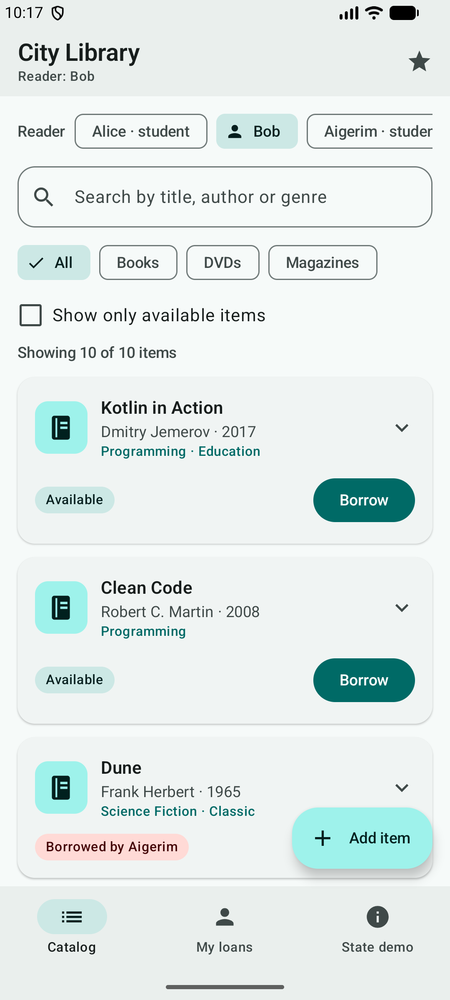
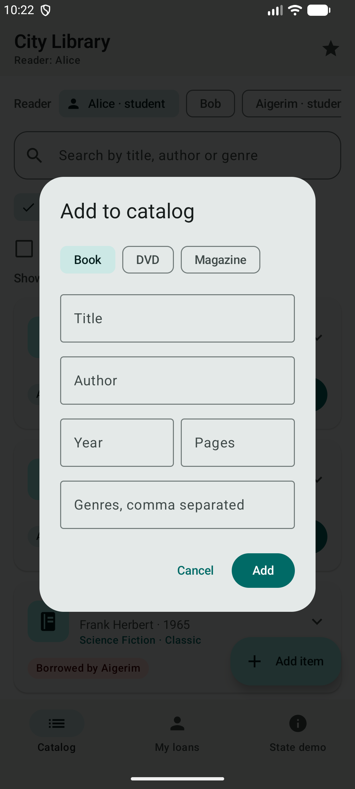
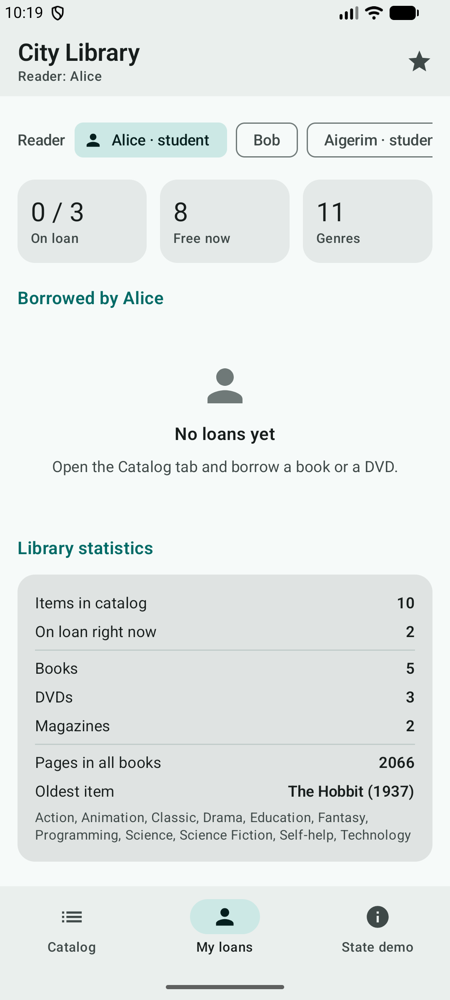
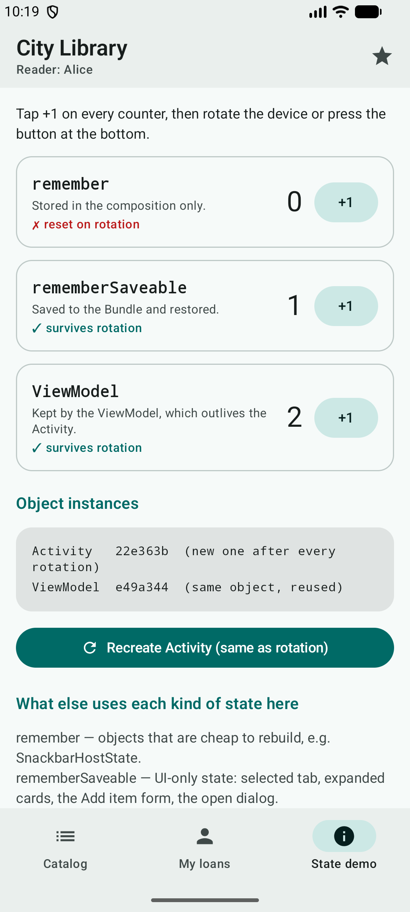

# City Library — Jetpack Compose app

An Android app for a small city library, written in **Kotlin** with **Jetpack Compose**, **Material 3** and a **ViewModel**.

It continues the HW1 console project [LibraryApp](../hw1): the same domain classes (`LibraryItem`, `Book`, `Dvd`, `Magazine`, the `Borrowable` interface, the `Member` data class and the `BorrowResult` sealed class) and the same rules (loan periods, a per-reader limit, magazines are reading-room only, a suspend function that "fetches" ratings) now drive a real Android UI.

## Features

- **Catalog** of books, DVDs and magazines in a `LazyColumn` of Material 3 cards, each with a type picture (`Image`), title, author/duration/issue, genres and an availability badge.
- **Search** by title, author or genre (`OutlinedTextField`), updated on every keystroke.
- **Filter** by type with chips (All / Books / DVDs / Magazines) and an **"only available"** `Checkbox`.
- **Switch reader** (Alice, Bob, Aigerim) with chips. The app shows what the selected reader can do.
- **Borrow and return** items with buttons. The ViewModel applies the HW1 rules and answers with a Snackbar: success, already borrowed, reading room only, or limit reached (3 items per reader).
- **Add a new item** (book, DVD or magazine) through a dialog form with validation (required title, author for books, year range, positive number).
- **Expand a card** to see the full description and rating.
- **Load ratings** (★ in the top bar): a coroutine fetches all ratings in parallel with `async` while a progress bar is shown.
- **My loans** tab: the selected reader's items plus library statistics computed with `map`, `filter`, `reduce` and `groupingBy`.
- **State demo** tab: three counters stored with `remember`, `rememberSaveable` and the `ViewModel`, the Activity and ViewModel instance ids, and a button that recreates the Activity exactly like a rotation does.
- Light and dark theme with a custom teal colour scheme.

## Screenshots

| Catalog | Add item |
|---|---|
|  |  |

| My loans | State demo after rotation |
|---|---|
|  |  |

## How to run

**Requirements:** Android Studio (recent stable version), Android SDK 35, an emulator or a phone with Android 8.0 (API 26) or newer. Android Studio's bundled JDK is enough.

1. Clone the repository:
   ```
   git clone https://github.com/aslanbekasylbekov/mobile-dev.git
   ```
2. In Android Studio choose **File → Open** and select the **`mobile-dev/hw2`** folder (the one with `settings.gradle.kts`).
3. Wait for **Gradle sync** to finish. Android Studio downloads Gradle 8.14.3 and all libraries automatically.
4. Pick an emulator or a connected device and press **Run ▶** (configuration `app`).

From a terminal: `./gradlew installDebug` (Windows: `gradlew.bat installDebug`), then open **City Library** on the device.

**To see rotation:** turn on *Auto-rotate* on the emulator/phone and rotate it (emulator: the rotate buttons in the side toolbar). Or open the **State demo** tab and press **Recreate Activity**, which goes through the same destroy-and-recreate cycle.

## Requirements checklist

| Requirement | Where |
|---|---|
| Kotlin + Jetpack Compose | whole project, `MainActivity.setContent { ... }` |
| Material 3, consistent styling | `ui/theme/` (one colour scheme, typography and shapes for all screens); `Scaffold`, `TopAppBar`, `NavigationBar`, `ElevatedCard`, `FilterChip`, `AlertDialog`, `Snackbar` |
| ≥ 3 reusable composables | `LibraryItemCard`, `ItemTypeIcon`, `StatusBadge`, `LibrarySearchField`, `TypeFilterRow`, `MemberSelector`, `LabeledCheckbox`, `StatCard`, `EmptyState`, `SectionHeader`, `CounterCard`, `AddItemDialog` |
| `Row`, `Column`, `Box` | card layout (`Row` of icon + `Column` of texts), `ItemTypeIcon` and `EmptyState` (`Box`), stat cards in a `Row` |
| `LazyColumn`, `Card`, `Text`, `Image` | catalog and loans lists, item cards, `Image(painterResource(...))` in `ItemTypeIcon` |
| ≥ 2 user interactions | search, type filter, availability checkbox, reader selection, borrow, return, add item, expand card, load ratings |
| Input components | `OutlinedTextField`, `Button`, `OutlinedButton`, `Checkbox`, `FilterChip`, `IconButton`, FAB |
| UI updates on user actions | every action changes `uiState` in the ViewModel, Compose redraws the affected parts |
| `remember` / `rememberSaveable` | see the next section |
| ViewModel | `ui/LibraryViewModel.kt` |
| UI separated from state | screens are stateless (`state` in, lambdas out); only `LibraryApp` talks to the ViewModel |
| Activity recreation | State demo tab, Logcat messages from `MainActivity` and `LibraryViewModel` |

## Architecture

```
app/src/main/java/com/aslanbek/libraryapp/
├── MainActivity.kt            entry point, sets the Compose content
├── model/Models.kt            domain classes from HW1 (interface, inheritance, data + sealed classes)
├── data/Library.kt            business rules: borrow, return, add, suspend fetchRating(); sample data
└── ui/
    ├── LibraryViewModel.kt    screen state + all logic, coroutines in viewModelScope
    ├── LibraryUiState.kt      immutable UI state, statistics, form validation
    ├── LibraryApp.kt          Scaffold, bottom navigation, Snackbar, dialog; connects UI to the ViewModel
    ├── screens/               CatalogScreen, LoansScreen, StateDemoScreen (stateless)
    ├── components/            reusable composables
    └── theme/                 Material 3 colours, typography, shapes
```

The app follows **unidirectional data flow**: the ViewModel exposes one immutable `LibraryUiState`; screens only read it and send events up (`onBorrow(id)`, `onQueryChange(text)`, ...). The ViewModel calls the `Library` class, then publishes a new copy of the state. Because `uiState` is Compose `State`, every composable that reads it is recomposed automatically.

## State and Activity recreation

When the device rotates, Android **destroys the Activity and creates a new one**. The whole composition is thrown away and built again. What survives depends on where the state is stored:

| Stored with | Survives rotation | Survives process death* | Used in this app for |
|---|---|---|---|
| `remember` | ✗ | ✗ | `SnackbarHostState`, the first counter on the State demo tab |
| `rememberSaveable` | ✓ | ✓ | selected tab, open "Add item" dialog and its typed text, expanded cards, the second counter |
| `ViewModel` | ✓ | ✗ | catalog, loans, selected reader, search text, filters, ratings and their loading coroutine, the third counter |

\* Process death: the system kills the app in the background to free memory. Saved state (`rememberSaveable`) is restored, but a plain ViewModel is created again from scratch.

**Try it:** on the State demo tab press +1 on all three counters, then rotate. The `remember` counter goes back to 0; the other two keep their values. The Activity id changes, the ViewModel id stays the same. Start loading ratings and rotate during loading: the progress keeps going because the coroutine lives in `viewModelScope`, not in the Activity.

### remember vs rememberSaveable vs ViewModel

- **`remember`** keeps a value across **recompositions**. It is stored inside the composition, so it is lost when the composable leaves the screen or when the Activity is recreated. Good for objects that are cheap to recreate.
- **`rememberSaveable`** works like `remember`, but also writes the value to the saved-instance-state `Bundle`. After rotation (and even after process death) the value is restored. Only small, Bundle-friendly values fit (primitives, strings, enums, `Parcelable`). Good for UI element state such as text being typed, a selected tab or an expanded item.
- **`ViewModel`** is a class that lives outside the composition and outside the Activity. One instance is kept for the screen while the user is on it, and the new Activity after rotation receives the same instance. It holds app data and business logic, can run coroutines in `viewModelScope`, and is cleared (`onCleared()`) only when the screen is closed for good.

Rule of thumb used here: **UI-element state → `remember`/`rememberSaveable`; screen data and logic → `ViewModel`.**

Note: `rememberSaveable` state inside one tab is reset when you switch to another tab and back, because that composable leaves the composition. Only state in the ViewModel (or saved higher up in `LibraryApp`) is shared between tabs.

## Tech stack

Kotlin 2.1 · Jetpack Compose (BOM 2024.12.01) · Material 3 · AndroidX Lifecycle ViewModel 2.8 · Kotlin Coroutines · Gradle 8.14 (Kotlin DSL, version catalog) · minSdk 26, targetSdk 35
