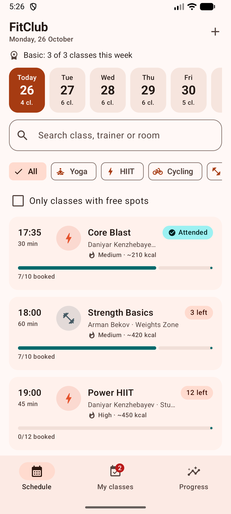
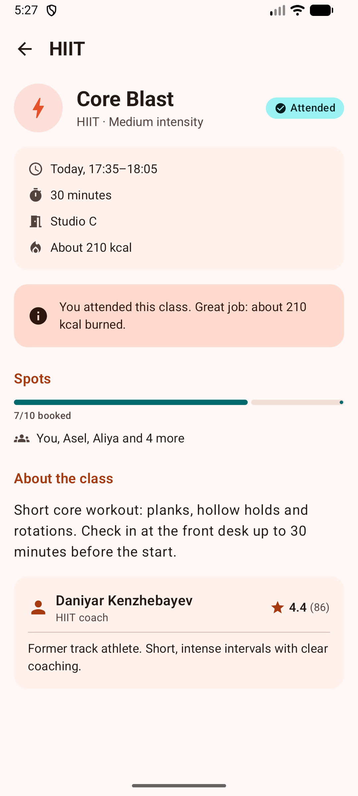
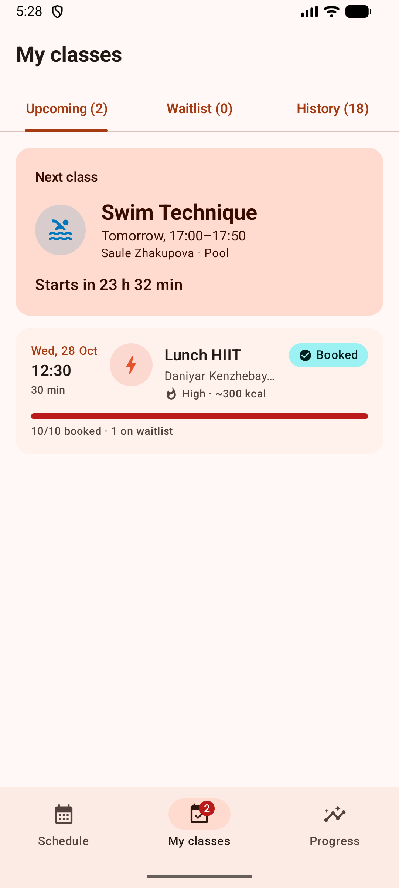
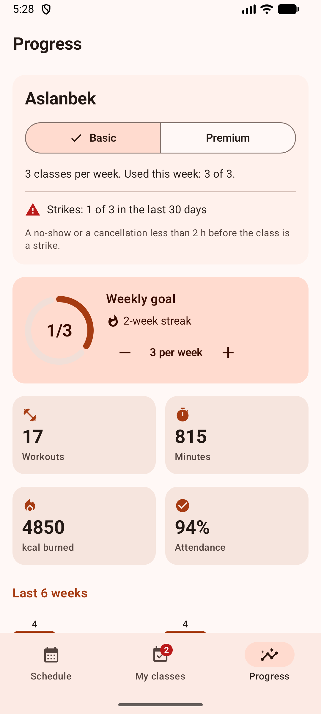

# FitClub — group workout booking (Midterm, Part 1)

FitClub is an Android app for members of a fitness club. You can see the weekly schedule of group classes (yoga, HIIT, cycling, strength, swimming), book a spot, join a waitlist when a class is full, check in at the club and track your progress toward a weekly goal.

It solves a real everyday problem: popular classes fill up quickly, people forget to cancel, and spots are wasted. FitClub applies the same rules a real club uses:

- **Membership limits.** Basic allows 3 classes per calendar week, Premium has no limit.
- **Waitlist.** When a class is full, you join a queue. When someone cancels, the first eligible person in the queue is booked automatically.
- **Fair-use policy.** A no-show or a cancellation less than 2 hours before the start counts as a strike. 3 strikes in 30 days pause booking.

The project continues the idea of my HW2 *City Library* app, applied to a new domain: classes are borrowed like books, a membership works like a borrowing limit, and booking results are modelled with a sealed class like `BorrowResult`.

Built with Kotlin, Jetpack Compose, Material 3, Navigation Compose, ViewModel + StateFlow and coroutines.

## Screenshots

| Schedule | Class details | My classes | Progress |
|---|---|---|---|
|  |  |  |  |

## Features

### 1. Class schedule (Schedule tab)
- Day picker for the next 7 days, showing the number of classes on each day.
- Search by class title, trainer or room. Filter chips by workout type. "Only classes with free spots" checkbox.
- Each card shows time, duration, trainer, room, intensity, estimated calories, a capacity bar and your status (`3 left`, `Full`, `Booked`, `Waitlist #2`).
- Your membership usage for the current week is shown at the top ("Basic: 2 of 3 classes this week").
- Landscape and tablets: the list switches to a two-column grid.

### 2. Booking, waitlist and check-in (Class details screen)
- **Book a spot**, **Join waitlist**, **Leave waitlist**, **Cancel booking** and **Check in**. The screen shows only the actions that make sense right now.
- Every booking is checked against the club rules: weekly limit, time conflict with another of your classes, strikes, and whether the class has already started. If a rule fails, a snackbar explains why.
- Cancelling less than 2 hours before the start opens a confirmation dialog, because it counts as a strike.
- Check-in opens 30 minutes before the start. A booked class that ends without a check-in automatically becomes a no-show.
- Trainer card with a rating loaded asynchronously, with a spinner while loading.

### 3. My classes
- Hero card for the next class with a live countdown ("Starts in 18 min") and a **Check in now** button.
- Tabs: Upcoming, Waitlist and History (Attended / No-show / Cancelled / Late cancel).
- The bottom navigation shows a badge with the number of upcoming bookings.

### 4. Progress
- Switch the membership between Basic and Premium. The new limit applies immediately to booking.
- Strikes counter and the "booking paused until…" date.
- Weekly goal ring with − / + buttons and a streak of consecutive weeks that reached the goal.
- Statistics: workouts, minutes, kcal and attendance rate. Bar chart for the last 6 weeks. Minutes by workout type.
- Trainer ratings loaded **in parallel** with `async`/`awaitAll`. The screen shows how long the load took (about 1 s instead of about 5 s sequentially).
- **Live club activity** switch: other members book and cancel in the background, so free spots change and the waitlist moves. When you get a spot from the waitlist, a snackbar tells you.

### 5. Add a class (trainer mode)
- Open it with the **+** button on the Schedule screen.
- Form with title, type, intensity, trainer, day, start time, duration, capacity, room and description.
- Validation shows the error under the field: title length, time format `HH:mm`, a start in the future, duration 15–180, capacity 1–40, and no overlap with another class in the same room or with the same trainer.

## Architecture

```
app/src/main/java/com/aslanbek/fitclub/
├── model/        Workout, Trainer, Member, Booking, enums, sealed results (BookingResult, CancelResult, CheckInResult, Participation)
├── domain/       Pure Kotlin business logic, no Android imports
│   ├── ClubState.kt         Immutable snapshot of the club + queries (spots left, waitlist position, strikes, weekly usage)
│   ├── ClubRules.kt         book / cancel / leaveWaitlist / checkIn / settle (no-shows) / addWorkout
│   ├── ClubActivity.kt      Simulation of other members
│   ├── ProgressStats.kt     Statistics with collections (groupBy, groupingBy, sumOf, maxBy…)
│   └── NewWorkoutInput.kt   Form validation
├── data/
│   ├── FitClubRepository.kt   Interface + in-memory implementation exposing StateFlow<ClubState>
│   ├── TrainerRatingService.kt  "Network" service with suspend functions and a Mutex-protected cache
│   ├── ClubClock.kt           Coroutine that ticks time forward and runs the simulation
│   └── SampleData.kt          Schedule for 5 past weeks + 7 days ahead, generated from the current date
├── di/AppContainer.kt         Manual dependency injection (one repository per app)
├── ui/
│   ├── FitClubApp.kt          Scaffold + NavigationBar + NavHost + global snackbar
│   ├── navigation/            Routes and top-level destinations
│   ├── schedule/  details/  bookings/  progress/  addworkout/   (Screen + ViewModel per feature)
│   ├── components/            Reusable composables (WorkoutCard, StatusPill, CapacityBar, ChoiceChipRow, DaySelector, StatCard…)
│   ├── theme/                 Material 3 color scheme, typography, shapes
│   └── util/                  Formats, ObserveAsEvents, ViewModel factory helper
├── FitClubApplication.kt      Creates AppContainer and starts the clock
└── MainActivity.kt            Only calls setContent { FitClubTheme { FitClubApp() } }
```

**Data flow (unidirectional):**

```
User taps "Book"  →  Screen calls viewModel.onAction(BOOK)
                  →  ViewModel calls repository.book(id)
                  →  Repository runs ClubRules.book(state, …) and publishes a new immutable ClubState in a StateFlow
                  →  Every ViewModel maps ClubState to its own UiState with combine/map + stateIn
                  →  Screens collect UiState with collectAsStateWithLifecycle() and recompose
```

Because all screens observe the same `StateFlow<ClubState>`, booking a class on the details screen updates the schedule card, the My classes tab, the badge on the bottom bar and the progress statistics at the same time.

### Navigation
- `NavHost` with 5 destinations: `schedule`, `bookings`, `progress` (bottom bar), `workout/{workoutId}` (Int argument) and `add_workout`.
- The bottom bar uses `popUpTo(startDestination) { saveState = true }`, `launchSingleTop` and `restoreState`, so each tab keeps its scroll and filters.
- `WorkoutDetailsViewModel` reads `workoutId` from its `SavedStateHandle`. Navigation puts the route arguments there automatically.
- The bottom bar is hidden on the details and add screens.

### State management
| Where | What | Why |
|---|---|---|
| `remember` | `SnackbarHostState`, coroutine scope | UI objects that must survive recomposition only |
| `rememberSaveable` | Form fields on *Add a class*, selected tab in *My classes*, late-cancel dialog visibility | Pure UI state that must survive rotation |
| `SavedStateHandle` | Schedule filters (day, search, type, only-free) | Survives rotation **and** process death |
| `ViewModel` + `StateFlow` | Screen data (`ScheduleUiState`, `WorkoutDetailsUiState`, …) | Survives rotation and holds logic |
| Repository `StateFlow<ClubState>` | The whole club (single source of truth) | Shared by all ViewModels |

- **State hoisting.** Every screen has a stateful `XxxRoute` (gets the ViewModel and collects state) and a stateless `XxxScreen(state, callbacks…)`. Components such as `DaySelector`, `ChoiceChipRow`, `SearchField` and `LabeledCheckbox` receive a value and an `onChange` lambda.
- **Lifecycle-aware collection.** `collectAsStateWithLifecycle()` for state. For one-time messages, `ObserveAsEvents` collects a `Channel`-based flow inside `repeatOnLifecycle(STARTED)`.
- **Configuration changes.** On rotation the Activity is recreated, but the ViewModels, the repository and the back stack survive. Saveable UI state is restored. Try it: type a search, open the *Add a class* form, fill some fields and rotate.

### Coroutines
- `viewModelScope.launch` for loading the trainer rating.
- `async { } … awaitAll()` for loading all trainer ratings in parallel, measured with `measureTimeMillis`.
- `combine(...)`, `map`, `stateIn(WhileSubscribed(5000))` to build UI state.
- `Channel` + `receiveAsFlow()` for one-time snackbar messages, and `SharedFlow` for notifications from the repository.
- An application-scoped `CoroutineScope(SupervisorJob() + Dispatchers.Default)` with a `while (isActive) { delay(...) }` loop that moves the clock forward and simulates other members.
- `Mutex` protects the rating cache, and `synchronized` makes repository updates atomic.

### Kotlin features used
Data classes, enums with properties, sealed classes and sealed interfaces with `data object`, extension functions and properties, higher-order functions, generics (`ChoiceChipRow<T>`, `Outcome<T>`), `by lazy` indices, destructuring, `when` as an expression, scope functions, collection operations (`groupBy`, `groupingBy().eachCount()`, `associateBy`, `sumOf`, `maxOfOrNull`, `flatMapIndexed`, `sortedWith(compareBy…thenBy)`, sequences), regex validation.

## Tests

The business rules and the UI-state builders are pure Kotlin, so they are covered by JVM unit tests (25 tests, no emulator needed):

- `ClubRulesTest`: booking, waitlist promotion, weekly limit per calendar week, time conflicts, late cancellation and strikes, blocking and expiry, check-in window, automatic no-show, skipping ineligible members in the waitlist.
- `StatsAndValidationTest`: week streak, sample data, form validation, simulation consistency (500 random events never overbook a class).
- `UiStateTest`: schedule filters, which actions the details screen offers, My classes lists, progress state.

Run them with: `./gradlew test`, or right-click `app/src/test` → *Run Tests* in Android Studio.

## How to run

1. Install **Android Studio** (Ladybug or newer). JDK 17 or 21 is required (the one bundled with Android Studio works).
2. Clone the repository and open the **`midterm`** folder in Android Studio (*File → Open…*). Gradle sync downloads the dependencies.
3. If Android Studio asks, accept the Android SDK licenses and install SDK Platform 35.
4. Create an emulator (*Device Manager → Pixel 7, API 34/35*) or connect a phone with USB debugging (Android 8.0+, minSdk 26).
5. Press **Run ▶** (configuration `app`).

From the command line: `./gradlew installDebug` (with a running emulator).

### Demo script
1. **Schedule:** switch days, search for "yoga", filter HIIT, tick "Only classes with free spots".
2. Open **Core Blast**. It starts in about 15 minutes and you are already booked. Tap **Check in**.
3. You already have 2 classes this week. Book one more, then try another one this week: it fails with the Basic limit (3 per week). On **Progress**, switch to **Premium** and book again.
4. Book two classes at the same time. The second shows "Overlaps with…".
5. **My classes → Waitlist:** you are #1 in a full class. Keep *Live club activity* on and wait about a minute. When another member cancels, you get the spot automatically and a snackbar says "A spot opened… You're booked!".
6. Cancel a booked class that starts in less than 2 hours to see the dialog, then check **Progress → Strikes**.
7. **+ on Schedule:** add a class. Try a wrong time like `25:00` or a busy room to see the validation.
8. Rotate the device on any screen. Filters, form fields and the selected tab stay.

## Tech stack

Kotlin 2.1 · Jetpack Compose (BOM 2024.12.01) · Material 3 · Navigation Compose 2.8.5 · Lifecycle ViewModel / runtime-compose 2.8.7 · Kotlin Coroutines & Flow · JUnit 4 · Gradle 8.14 (Kotlin DSL, version catalog) · minSdk 26, targetSdk 35

## Plans for Part 2

- Replace `InMemoryFitClubRepository` with a Room-backed implementation. The `FitClubRepository` interface stays the same.
- Load the schedule and trainer ratings from a REST API (Retrofit) instead of `SampleData` and the fake service.
- WorkManager reminder one hour before a booked class, and a periodic job that marks no-shows.
